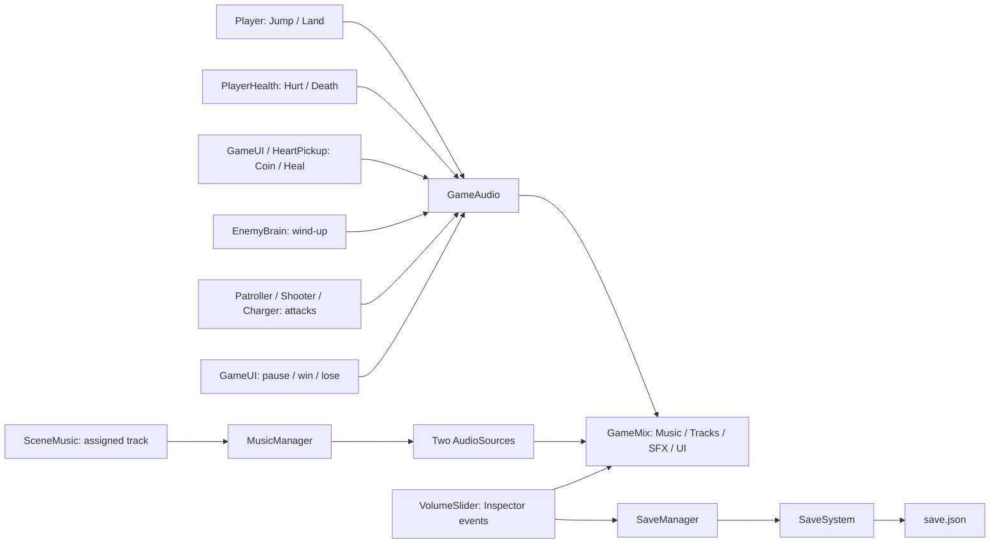

# Assignment 12 — Sound Pass

## Что изменено

- GameAudio: один постоянный объект, четыре AudioSource, две музыкальные дорожки с crossfade 1 секунда.
- GameMix: Master → Music → Tracks, Master → SFX, Master → UI. Все источники GameAudio направлены в микшер.
- MasterVol, MusicVol и SFXVol: перевод 0–1 в dB, сохранение в прежнем save.json.
- Normal и Paused: Tracks 0 / -6 dB, Lowpass Simple 22000 / 800 Hz. Переход 0.3 секунды работает при Time.timeScale = 0.
- 16 звуковых событий, предупреждения в начале подготовки каждой наземной атаки, pitch 0.92–1.08. Три варианта урона через SfxPlayer.
- Музыка одна для всех трёх уровней. Повторный запуск уровня не запускает дорожку заново.

Проверки Unity Play Mode пройдены. Результаты в Lecture-alignment-checks.txt. Сохранение после проверки восстановлено побайтно. Реальный перезапуск приложения на телефоне и оценка громкости на его динамике ещё требуют проверки.

Скриншот для Canvas нужно сделать заново в окне AudioMixer с текущими группами Master, Music, Tracks, SFX и UI. Карта для видео: Assignment-12-script-map.svg.

## Карта скриптов

## Проверка на телефоне

1. В паузе выставить Music примерно 40%, Sound примерно 60%.
2. Полностью закрыть приложение через список приложений телефона.
3. Снова открыть приложение, зайти в паузу и показать те же ползунки и громкость.
4. Проверить, что предупреждение слышно поверх музыки на динамике телефона.

Unity Remote не доказывает перезапуск установленной игры: сохранение в этом случае находится на компьютере. Если нет установленной iPhone-сборки, согласовать способ демонстрации с преподавателем.

## Сценарий MP4, английский A2 с переводом

### 0:00–0:20 — меню и переход в игру

Hi! This is my game, Skybound. I added music and sound effects. This is the menu music. When I press Play, the music changes slowly to the level music.

Привет! Это моя игра Skybound. Я добавила музыку и звуковые эффекты. Это музыка меню. Когда я нажимаю Play, она плавно меняется на музыку уровня.

### 0:20–0:45 — прыжок, монета, урон и кнопка

You can hear a sound when I jump, land, collect a coin, and take damage. Buttons also have a click sound. Repeated sounds have a small change in pitch.

Слышен звук, когда я прыгаю, приземляюсь, собираю монету и получаю урон. У кнопок тоже есть звук нажатия. Высота повторяющихся звуков немного меняется.

### 0:45–1:15 — второй уровень, предупреждения и атаки

Each enemy has a warning sound before it attacks. The patroller, shooter, and charger have different sounds. I hear the warning before the enemy hits me. This gives me time to jump away.

У каждого врага есть предупреждающий звук перед атакой. У патрульного, стрелка и таранщика разные звуки. Я слышу предупреждение до того, как враг наносит удар. Это даёт мне время отпрыгнуть.

Показать настоящий момент предупреждения, затем выстрел и рывок. Правило предупреждения вне кадра из лекции 12 расходится с правилом начала wind-up в кадре из лекции 10. Сейчас враги готовятся и атакуют в кадре, это ограничение указано в Lecture-project-audit.txt.

### 1:15–1:30 — короткие фрагменты смерти и победы

There are also sounds for death, losing, and winning. They help the player understand the result.

Есть также звуки смерти, поражения и победы. Они помогают игроку понять результат.

### 1:30–1:50 — пауза и микшер

When I pause the game, the music becomes quieter and softer. This is my AudioMixer. It has Master, Music, and SFX groups. The Paused snapshot changes the music sound.

Когда я ставлю игру на паузу, музыка становится тише и приглушённее. Это мой AudioMixer. В нём есть группы Master, Music и SFX. Snapshot Paused изменяет звучание музыки.

### 1:50–2:15 — проверка сохранения на телефоне

I change the music and sound volume. Now I close the app completely and open it again. The volume settings are still the same.

Я меняю громкость музыки и звуков. Теперь полностью закрываю приложение и открываю его снова. Настройки громкости остались такими же.

Этот фрагмент записать на настоящем телефоне после проверки.

### 2:15–2:45 — карта скриптов и источники

This is my script map. The player, enemies, and buttons send sound events to Game Audio. Game Audio plays the sounds through the mixer. The volume settings go to Save Manager and the JSON file. My sounds are made with simple sound synthesis. Their sources are in the README. Thank you for watching!

Это моя карта скриптов. Игрок, враги и кнопки отправляют звуковые события в Game Audio. Game Audio воспроизводит звуки через микшер. Настройки громкости передаются в Save Manager и JSON-файл. Мои звуки созданы простым синтезом. Их источники указаны в README. Спасибо за просмотр!

## Что сдать

- Ссылка на репозиторий с коммитами недели, README и DECISIONS.md.
- Скриншот AudioMixer с группами и Paused.
- MP4 2–3 минуты с игровым звуком и собственным голосом на английском.
- APK или для iPhone короткое видео с телефона.

Запись голоса, реальный тест на телефоне и загрузка в Canvas не выполнены автоматически.

